# Case 5 — Opzeggingen slim routeren (n8n)

Werkende n8n-workflow die een inzending van de opzegsurvey van begin tot eind verwerkt: **ontvangen → verrijken → business-regels → ActiveCampaign (MailBlue) → signalen voor Customer Success**, met foutafhandeling waarbij geen enkele opzegging verloren gaat. Gebouwd met n8n 2.47 (self-hosted, lokaal) en [n8n-as-code](https://github.com/EtienneLescot/n8n-as-code). De workflows staan als TypeScript in Git en worden naar n8n gepusht.

---

## 1. Doel

Een klant vult de opzegsurvey in en kiest daarin: **definitief opzeggen**, **pauzeren** (max. 4 maanden), **20% korting op de verlenging** of **een persoonlijk aanbod**. Daarna moet CS aan de slag. Nu gaat het volgende mis:

| Probleem nu | Oplossing in deze workflow |
|---|---|
| Deals komen in de verkeerde stage. Pauze + persoonlijk aanbod komt **dubbel** binnen | Eén deal per klant. Bij meerdere keuzes bepaalt een vaste **prioriteit** de stage. Bestaat er al een **open opzeg-deal**, dan wordt die **bijgewerkt** in plaats van een nieuwe aangemaakt |
| Engelstalige klanten krijgen geen bevestiging | Taal wordt bepaald (survey → backoffice). Die komt in het standaardveld **Preferred Language** van het contact. Eén tag **`opzegsurvey-bevestiging`** start in MailBlue één automation, die op dat veld de NL- of EN-mail kiest |
| Het signaal "grote klant → persoonlijk contact" valt weg | **ARR incl. add-ons ≥ € 3.000** geeft altijd een CS-taak en een Slack-melding, ongeacht de keuze |
| Openstaande facturen zie je pas in MoneyBird | MoneyBird wordt bevraagd. Het **bedrag en de dagen over de vervaldatum** staan in de deal-notitie en de taak. Bij een pauze- of kortingsaanvraag krijgt dat een expliciet **⚠ aandachtspunt** |

## 2. Wat er gebouwd is

| Workflow | Rol |
|---|---|
| **02 Opzegsurvey – Verwerken** | De hoofdflow (webhook `POST /webhook/opzegsurvey`) |
| 00 Setup – Mock data | Maakt de mock-"software" aan in n8n Data Tables en vult die met de case-data. Dient ook als demo-reset |
| 01 Mock – MoneyBird API | Mock van `GET /api/v2/{administratie}/sales_invoices`, met dezelfde filtersyntax en hetzelfde antwoordformaat als MoneyBird |
| 03 Foutafhandeling | Error-workflow van 02: crasht er toch iets, dan volgt een alert in `#cs-alerts` met een link naar de execution |
| 04 Watchdog | Elk kwartier: staat er nog een inzending op `received` die ouder is dan 10 minuten? Dan volgt één alert en gaat de status naar `escalated`, zodat CS niet elk kwartier dezelfde melding krijgt |

```mermaid
flowchart LR
  A[Webhook<br/>survey] --> B[Normaliseren<br/>& valideren]
  B --> C{Al verwerkt?<br/>submission_id}
  C -- ja --> C1[200 duplicate]
  C -- nee --> D[(submission_log<br/>status received)] --> E[202 accepted]
  E --> F[(Backoffice<br/>Data Table)] --> G{Klant<br/>gevonden?}
  G -- ja --> H[MoneyBird API<br/>3 pogingen]
  H -- ok --> I[Facturen samenvatten]
  H -- fout --> I2[MoneyBird onbekend<br/>+ aandachtspunt]
  G -- nee --> I3[Geen factuurcheck]
  I & I2 & I3 --> J{Open antwoord?}
  J -- ja --> K[AI: samenvatten<br/>+ categoriseren] --> L[AI-output valideren]
  J -- nee --> M
  L --> M[Routing bepalen<br/>alle regels]
  M --> N[AC: contact sync] --> O{Open opzeg-deal?}
  O -- ja --> P1[AC: deal bijwerken]
  O -- nee --> P2[AC: deal aanmaken]
  P1 & P2 --> Q[AC: notitie] --> R[AC: tag bevestiging]
  R --> S{Taak nodig?} --> T[AC: taak voor CS]
  T --> U{Slack nodig?} --> V[Slack-melding]
  V --> W[(submission_log<br/>processed)]
```

## 3. Systemen: wat is echt en wat is een mock

| Systeem | Hier | Waarom |
|---|---|---|
| **CRM: MailBlue / ActiveCampaign** | **Echt** (ActiveCampaign-trial, API v3) | MailBlue draait op ActiveCampaign. Juist stages, de check op een bestaande deal, notities, tags en taken zijn de kern van de case, en die wil je tegen de echte API zien werken |
| Backoffice | n8n **Data Table** `backoffice_customers` | Dit is de "data store" uit de case. Werkt zonder externe OAuth en is in de video live te laten zien |
| MoneyBird | **Mock-API** (workflow 01) op een Data Table | Hetzelfde endpoint, dezelfde filter (`state:open\|late,contact_id:…`) en dezelfde velden (`total_unpaid`, `due_date`, `state`) als MoneyBird. Voor productie wissel je alleen de base-URL en de credential. **Storing testen = workflow 01 uitzetten** |
| Slack | Mock: Data Table `c5_slack_messages` | De case staat een mock toe. De berichttekst is precies wat de Slack-node in productie post |
| AI | **Echt**: Google Gemini (flash-lite) | Goedkoop en snel. Het model is via de n8n-credential te wisselen (bijv. Claude) |

## 4. De hoofdworkflow (02), node voor node

| # | Node | Type | Wat | Waarom |
|---|---|---|---|---|
| 1 | Webhook opzegsurvey | Webhook | `POST /opzegsurvey`, antwoord via een Respond-node | Een Respond-node laat ons zelf bepalen wanneer we "ontvangen" zeggen: pas na het loggen |
| 2 | Config | Code | Drempel € 3.000, max. 4 maanden pauze, URL's, AC-ID's (pipeline, stages, tag, taalveld) | Eén plek voor alles wat per omgeving verschilt. Geen magische waarden verspreid over 40 nodes |
| 3 | Normaliseren & valideren | Code | `choice` wordt altijd een unieke lijst, taal nl/en/null, e-mail gecontroleerd, pauze begrensd op 4 | Elke payload krijgt één voorspelbare vorm. Fouten worden **aandachtspunten** (`issues[]`), geen crash |
| 4–5 | Al eerder ontvangen? / Al verwerkt? | Data Table + If | Zoekt `submission_id` in `submission_log` | **Idempotentie**: een webhook die twee keer binnenkomt, maakt niets dubbel |
| 6 | Inzending loggen | Data Table (upsert) | Ruwe payload met status `received` | **Eerst vastleggen, dan bevestigen.** Crasht iets daarna, dan staat de inzending er nog en ziet de watchdog hem |
| 7 | Antwoord: ontvangen (202) | Respond | `{"status":"accepted"}` | De survey-tool hoeft niet te wachten op ActiveCampaign, MoneyBird en AI |
| 8 | Backoffice opzoeken | Data Table | Zoekt op `customer_id` **óf** e-mail | Payload 3 heeft `customer_id: null`. Zoeken op e-mail is dan de tweede kans |
| 9 | Klant bepalen | Code | Match op ID gaat voor e-mail. ARR = abonnement + **add-ons**. Topklant ≥ € 3.000. Taal: survey → backoffice → nl | Blauwdruk is alleen dankzij de add-ons een topklant (€ 1.788 + € 1.440 = € 3.228) |
| 10 | Klant gevonden? | If | | Zonder klant is er geen MoneyBird-contact om te bevragen |
| 11 | MoneyBird: open facturen | HTTP Request | `GET …/sales_invoices?filter=state:open\|late,contact_id:…`. Timeout 5 s, **3 pogingen**, error-uitgang | Hapert MoneyBird, dan stopt de opzegging niet |
| 12 | Facturen samenvatten / MoneyBird niet bereikbaar / Geen MoneyBird-check | Code | Bedrag en dagen over de vervaldatum, of "onbekend, controleer handmatig" | Alle drie de paden leveren dezelfde vorm aan, waardoor de rest van de flow niet hoeft te weten welk pad er liep |
| 13 | Feedback aanwezig? | If | | Geen AI-call (en geen kosten of fouten) bij een leeg antwoord |
| 14 | AI: feedback analyseren + Gemini | Information Extractor | JSON-schema: samenvatting, categorie (vaste lijst), wil_hulp, bruikbaar. Temperatuur 0, 2 pogingen, error-uitgang | Gestructureerde output in plaats van vrije tekst. Zie §6 |
| 15 | AI-output valideren / AI mislukt | Code | Categorie buiten de lijst wordt `overig`, lengte begrensd, injectie-check | Zie §6 |
| 16 | Routing bepalen | Code | **Alle business-regels** op één plek (§5). Bouwt de deal-titel, notitie, taak en Slack-berichten | Regels zijn leesbaar en testbaar op één plek, in plaats van verstopt in 15 filters |
| 17 | AC: contact synchroniseren | HTTP (AC-credential) | `contact/sync` op e-mail, met **Preferred Language** = nl/en | Bestaat het contact al, dan wordt het bijgewerkt, anders aangemaakt. Ook een onbekende klant krijgt zo een deal en een bevestiging. Is de taal onbekend, dan wordt het veld niet overschreven. Daarom de API: de AC-node kan een custom field niet voorwaardelijk weglaten |
| 18 | AC: deals van contact | HTTP Request (AC-credential) | `GET /api/3/contacts/{id}/deals` | De ActiveCampaign-node kan deals niet filteren |
| 19 | Open opzeg-deal zoeken | Code | Open deal (status 0) in de opzeg-pipeline? | **Regel (e)**: bijwerken in plaats van een dubbele deal |
| 20 | AC: deal bijwerken / aanmaken | ActiveCampaign | Stage, titel, waarde (ARR, in centen) | |
| 21 | AC: notitie toevoegen | ActiveCampaign | Volledige context voor CS | CS hoeft niet meer in drie systemen te kijken |
| 22 | AC: bevestigingstag toevoegen | ActiveCampaign | `opzegsurvey-bevestiging` | De tag is de gebeurtenis "stuur nu een bevestiging". De taal staat al in Preferred Language. Een veld alleen werkt niet als trigger: blijft de taal gelijk, dan start een automation op "veld gewijzigd" niet |
| 23 | Taak nodig? → AC: taak voor CS | If + HTTP Request | `POST /api/3/dealTasks` | **Eén** taak met alle redenen, in plaats van losse taken die door elkaar gaan lopen |
| 24 | Slack nodig? → Slack-melding (mock) | If + Data Table | `#cs-topklanten` of `#cs-alerts` | |
| 25 | Afronden in log | Data Table (update) | Status `processed`, deal-ID, stage, aandachtspunten | Audit trail. De watchdog weet zo dat de inzending klaar is |

## 5. Business-regels (node "Routing bepalen")

- **Stage bij meerdere keuzes**: *persoonlijk aanbod > pauze > korting > definitief opzeggen.* Elke behoudoptie betekent dat de klant openstaat voor blijven, en CS kiest de meest persoonlijke actie. De andere keuzes staan in de notitie ("gaat voor: Pauze aangevraagd").
- **Te verifiëren**: als de klant niet gevonden is of de keuze ongeldig is. Zo komt de inzending wel in de pipeline, met een taak om de klant te identificeren.
- **Topklant**: ARR abonnement + add-ons ≥ € 3.000 geeft altijd een taak "persoonlijk contact" en een melding in `#cs-topklanten`.
- **Openstaande factuur**: komt altijd in de notitie. Bij pauze of korting volgt een ⚠ aandachtspunt en daarmee ook een taak.
- **Pauze > 4 maanden**: wordt begrensd op 4 en komt als aandachtspunt bij de taak, zodat CS het in het gesprek kan bespreken.
- **Taak nodig** bij: topklant, persoonlijk aanbod, onbekende klant, aandachtspunt over een factuur, of andere aandachtspunten. De deadline is morgen (topklant of onbekende klant) of over 2 dagen.

## 6. AI-stap: hoe hij de flow niet breekt en geen onzin wegschrijft

1. Hij draait **alleen als er tekst is**.
2. **Structured output**: een JSON-schema met een **vaste categorielijst**, temperatuur 0.
3. **De AI-node heeft een error-uitgang** en 2 pogingen. Bij een fout of timeout loopt de flow door zonder samenvatting.
4. **Validatie in code**: een categorie buiten de lijst wordt `overig`, de samenvatting wordt begrensd en een lege output wordt weggegooid.
5. **Twee lagen tegen prompt-injectie**: het model markeert niet-feedback met `bruikbaar=false`, en een vaste regex-check doet hetzelfde. Bij een treffer wordt geen AI-tekst weggeschreven, alleen een aandachtspunt (getest met payload 06).
6. **De AI vult aan, maar vervangt niets**: het originele antwoord staat altijd in de notitie. De samenvatting is gelabeld als *"automatisch, controleer"*.

## 7. Foutafhandeling ("niemand mag een opzegging missen")

| Situatie | Gedrag |
|---|---|
| Klant niet gevonden | Contact wordt op e-mail aangemaakt, deal in **Te verifiëren**, taak, en een alert in `#cs-alerts` |
| `customer_id` ontbreekt | Klant wordt gezocht op e-mail |
| Taal ontbreekt | Backoffice-taal. Is die er ook niet, dan wordt Preferred Language niet aangepast, gaat de bevestiging standaard in het NL en komt er een aandachtspunt |
| Keuze ontbreekt of is onbekend | Stage Te verifiëren en een taak |
| Pauze te lang of zonder aantal maanden | Begrensd of gemarkeerd, met een aandachtspunt |
| MoneyBird reageert niet | 3 pogingen, daarna "controleer handmatig" in de notitie en de taak, en een alert |
| AI faalt of geeft onzin | Flow gaat door zonder AI (§6) |
| Dubbele webhook | 200 `duplicate`, niets dubbel |
| ActiveCampaign onbereikbaar of onverwachte crash | 3 pogingen per AC-call. Daarna error-workflow **03** (alert met execution-link). De inzending staat in `submission_log`, dus watchdog **04** meldt hem na 10 minuten (één keer, daarna status `escalated` tot iemand hem afhandelt) |

## 8. Datamodel

- **ActiveCampaign**: pipeline *Opzeg-pipeline* met stages *Te verifiëren · Persoonlijk aanbod · Pauze aangevraagd · Korting 20% aangevraagd · Opzegging definitief*. Tag `opzegsurvey-bevestiging`. Standaardveld *Preferred Language* (dropdown, nl/en). Taaktype Call.
- **Data Tables**: `backoffice_customers`, `moneybird_invoices`, `c5_slack_messages`, `submission_log`.
- Alle data is fictief en staat in [`mock-data/`](mock-data/).

## 9. Testscenario's

| Payload | Verwacht resultaat |
|---|---|
| **01** korting, nl (Blauwdruk) | Nieuwe deal *Korting 20%*. Topklant (€ 3.228 door add-ons): taak + Slack. Notitie met € 149 / 51 dagen ⚠. Tag nl. AI: categorie templates_content |
| **02** pauze + aanbod, en (Northwind) | **Bestaande** open deal bijgewerkt naar *Persoonlijk aanbod* (geen tweede deal). Pauze 5 → 4 gemarkeerd. Topklant: taak + Slack. Tag en. AI overgeslagen (leeg) |
| **03** opzegging, onvolledig | Klant niet gevonden: contact aangemaakt, deal *Te verifiëren*, Preferred Language niet aangepast (gemarkeerd), MoneyBird n.v.t., taak + `#cs-alerts` |
| 04 pauze, kleine klant | Geen topklant. Open factuur € 49 bij pauze: taak met aandachtspunt, geen Slack |
| 05 = 01 nogmaals | `200 duplicate`, niets dubbel |
| 06 prompt-injectie | Categorie `overig`, géén AI-samenvatting weggeschreven, aandachtspunt "lees het origineel" |
| Workflow 01 uitgezet | MoneyBird faalt na 3 pogingen: flow loopt door, "controleer handmatig" + alert |

## 10. Zelf draaien

1. Importeer `export/*.json` in n8n (of push de `.workflow.ts`-bestanden met `n8nac push`).
2. Maak de credentials aan: *ActiveCampaign API*, *Google Gemini API* en *Header Auth* "MoneyBird API (mock)" (`Authorization: Bearer …`).
3. `python3 scripts/setup_activecampaign.py` zet pipeline, stages, de tag, het taalveld, contacten en de seed-deal klaar. Zet de geprinte ID's in de **Config**-node.
4. Activeer 00 en `curl -X POST <n8n>/webhook/setup-mock-data` om de Data Tables te vullen. Activeer daarna 01, 02, **03** en 04. Let op: in n8n 2.x wordt een error-workflow alleen gestart als hij zelf **actief** is.
5. `scripts/run_demo.sh --reset --extra` stuurt alle payloads en toont de stand in ActiveCampaign.

### Bevestigingsmail in MailBlue (één automation, in de AC-interface)
Trigger: *Tag is toegevoegd* `opzegsurvey-bevestiging`. Daarna een **If/Else** op *Preferred Language* is English: ja → Engelse mail, nee → Nederlandse mail. Een leeg veld valt zo terug op NL. Als **laatste stap verwijder je de tag weer**, zodat een volgende survey opnieuw een bevestiging stuurt.

## 11. Screenshots

| | |
|---|---|
| Overzicht hoofdworkflow | [`screenshots/02-overzicht.png`](screenshots/02-overzicht.png) |
| Per fase | `screenshots/02-1-…` t/m `02-6-…` |
| Payload 1: verrijken, AI, signalen | `screenshots/exec-1-payload1-korting-nl*.png` |
| Payload 2: **bestaande deal bijgewerkt** (true-pad) | `screenshots/exec-2-payload2-pauze-aanbod-en-detail-activecampaign.png` |
| Payload 3: klant niet gevonden | `screenshots/exec-3-payload3-onvolledig*.png` |
| Duplicaat · prompt-injectie · MoneyBird-storing · niet-identificeerbaar (error-workflow) | `screenshots/exec-5…`, `exec-6…`, `exec-7…`, `exec-8…` |
| Data Tables (log, Slack-mock, backoffice, MoneyBird) | `screenshots/datatable-*.png` |
| Hulpworkflows 00/01/03/04 | `screenshots/wf0*.png` |

Zie [TOELICHTING.md](TOELICHTING.md) voor de keuzes, de edge cases en wat er vóór productie moet gebeuren.
